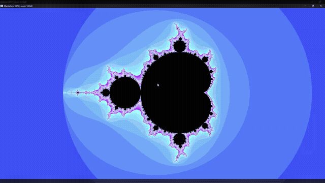

# Insieme di Mandelbrot

Un piccolo progetto in Rust che calcola e visualizza l'insieme di Mandelbrot in una finestra desktop.

<p align="center">
  
</p>

[Guarda il video in formato MP4](img/demo.mp4).

## Come funziona

Per ogni pixel viene considerato un punto complesso `c` e si calcola iterativamente la successione:

```text
z(n + 1) = z(n)² + c
```

Il numero di iterazioni, fino a un massimo di 150, determina il colore del pixel. I punti che non superano il limite di fuga restano neri; gli altri sono colorati con una sfumatura a dominante blu. Il calcolo viene eseguito dalla GPU e usa test rapidi per saltare le iterazioni sui punti sicuramente interni all'insieme.

La finestra si apre a 1200 × 950 pixel e può essere ridimensionata; il disegno si adatta alla sua risoluzione. La vista iniziale è centrata su `-0.5 + 0i`.

L'insieme di Mandelbrot contiene i valori di `c` per cui la successione resta limitata. In pratica, i pixel neri rappresentano punti che non superano il limite di fuga entro il numero massimo di iterazioni; quelli colorati rappresentano punti che lo superano.

## Tecniche implementate

- **Rendering parallelo sulla GPU:** `wgpu` disegna un triangolo a schermo intero; lo shader WGSL calcola in parallelo il colore di ogni pixel. Centro, scala, dimensioni della finestra e numero massimo di iterazioni vengono passati allo shader tramite un buffer uniform.
- **Test di appartenenza rapidi:** prima di avviare le iterazioni, lo shader verifica se il punto `c = (a, b)` si trova nella cardioide principale o nel bulbo periodico di periodo 2. In questi casi il punto è sicuramente interno e viene colorato subito di nero:

  ```text
  q = (a - 1/4)² + b²
  q(q + a - 1/4) ≤ b²/4
  (a + 1)² + b² ≤ 1/16
  ```

- **Criterio di fuga:** per gli altri punti, l'iterazione termina quando `z_a² + z_b² > 4` oppure dopo 150 iterazioni.
- **Ridisegno su richiesta:** il programma attende gli eventi e aggiorna i parametri dello shader quando la vista cambia o la finestra viene ridimensionata, invece di ricalcolare continuamente un'immagine invariata. Dopo il rendering, il frame viene presentato alla finestra.

## Controlli

- Trascina con il tasto sinistro del mouse per spostarti nell'immagine.
- Usa la rotella del mouse per zoomare, mantenendo come riferimento il punto sotto il cursore. La scala è limitata per evitare zoom eccessivi.

## Requisiti

- [Rust](https://www.rust-lang.org/tools/install) e Cargo (edizione Rust 2024)
- Una piattaforma desktop supportata da `winit`

Il progetto usa [`winit`](https://crates.io/crates/winit) per la finestra e gli eventi e [`wgpu`](https://crates.io/crates/wgpu) per il rendering sulla GPU.

## Avvio

Dalla cartella del progetto, compila ed esegui con:

```bash
cargo run
```

Per creare ed eseguire una build ottimizzata:

```bash
cargo run --release
```

Chiudi la finestra per terminare il programma.


