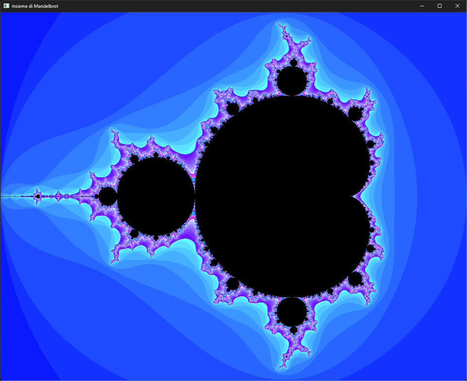

# Insieme di Mandelbrot

Un piccolo progetto in Rust che calcola e visualizza l'insieme di Mandelbrot in una finestra desktop.



## Come funziona

Per ogni pixel viene considerato un punto complesso `c` e si calcola iterativamente la successione:

```text
z(n + 1) = z(n)² + c
```

Il numero di iterazioni, fino a un massimo di 150, determina il colore del pixel. I punti che non superano il limite di fuga restano neri; gli altri sono colorati con una sfumatura a dominante blu.

La scena viene calcolata a 1200 × 950 pixel e mostrata in una finestra ridimensionabile. Il disegno è statico: al momento non sono disponibili comandi per zoomare o spostarsi sull'immagine.

Questo insieme rappresenta il complesso dei numeri complessi e la loro stabilita i pixel neri puntano numeri complessi che riescono a rimanere stabili dopo tante iterazioni mentre quelli all esterno sono quelli piu propensi a "scappare" verso l infinito.

## Requisiti

- [Rust](https://www.rust-lang.org/tools/install) e Cargo (edizione Rust 2024)
- Una piattaforma desktop supportata da `winit`

Il progetto usa [`winit`](https://crates.io/crates/winit) per la finestra e gli eventi e [`pixels`](https://crates.io/crates/pixels) per visualizzare l'immagine.

## Avvio

Dalla cartella del progetto, compila ed esegui con:

```bash
cargo run
```

Per creare ed eseguire una build ottimizzata:

```bash
cargo run --release
```

Chiudi la finestra per terminare il programma.
